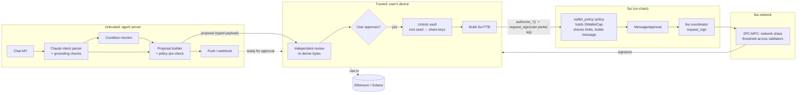

# AI Wallet Agent on Ika zero-trust dWallets

A personal wallet agent you talk to in plain language. It watches prices and balances and prepares transactions on Ethereum and Solana. **It can't sign.** Every signature needs three things:

1. **The on-chain policy says yes.** A Sui Move contract checks your limits, builds the exact bytes to be signed, and is the only thing that can issue an Ika `MessageApproval`.
2. **You say yes on your own device.** Your wallet re-derives what will be signed (it doesn't trust the agent's description), shows it to you, and waits for your explicit approval.
3. **Your user share and Ika's network share both take part.** It's a zero-trust dWallet (2PC-MPC). The full private key is never assembled anywhere.

```
AI proposes  ──►  wallet reviews  ──►  you approve  ──►  policy checks + builds bytes  ──►  user share + network share sign
 (untrusted)      (your device)                         (Sui Move, atomic PTB)              (Ika 2PC-MPC)
```

Try it offline in 10 seconds:

```bash
npm install
npm run demo   # full critical path + 5 attacks it blocks (mocked chain/Ika)
npm test       # 31 tests: encoders vs viem/@solana/web3.js, policy mirror, grounding, critical path
```

## Contents

| Doc | What's in it |
|---|---|
| [docs/ARCHITECTURE.md](docs/ARCHITECTURE.md) | Diagrams, components, trust boundaries, tech stack, folder layout |
| [docs/SECURITY.md](docs/SECURITY.md) | Threat model and security considerations specific to AI + MPC wallets |
| [docs/CONVERSATION.md](docs/CONVERSATION.md) | Example conversations between the user and the agent |
| [docs/IMPLEMENTATION_PLAN.md](docs/IMPLEMENTATION_PLAN.md) | Build order, testnet bring-up, what's left before mainnet |

## Architecture at a glance



**Hard rule:** the `DWalletCap` gets wrapped inside the shared `Policy` object in the same transaction that creates the dWallet. No address ever holds it, so the only way to get a `MessageApproval` is through one of the policy's `authorize_*` functions. Those functions enforce:

- daily USD spend limit (oracle prices with a staleness bound)
- daily transaction count
- token allow-list plus a per-transaction cap per token (works without the oracle)
- destination allow-list
- max slippage (checked on-chain against oracle prices)
- per-chain gas caps (otherwise fees could drain the wallet)
- EVM nonce tracking
- owner-only authorization, pause, and a 48h timelock on loosening any rule (cold admin key)

## The critical code, in reading order

| Step | File |
|---|---|
| DKG: zero-trust dWallet, encrypted user share, cap locked into the policy | [`src/wallet/dkg.ts`](src/wallet/dkg.ts) |
| On-chain policy: limits, message construction, `approve_message` | [`contracts/policy/sources/policy.move`](contracts/policy/sources/policy.move) |
| Signing: review → approve → policy → **user share** → network | [`src/wallet/sign.ts`](src/wallet/sign.ts) |
| Independent proposal review on the device | [`src/wallet/review.ts`](src/wallet/review.ts) |
| Byte-exact encoders (Move ⇄ TS, tested against viem / web3.js) | [`src/core/encoding/`](src/core/encoding), [`contracts/policy/sources/evm.move`](contracts/policy/sources/evm.move) |
| Natural language → intent (Claude structured outputs + grounding) | [`src/agent/intent/parser.ts`](src/agent/intent/parser.ts) |
| Intent → proposal (+ policy pre-check) | [`src/agent/proposals/builder.ts`](src/agent/proposals/builder.ts) |
| Conditions, notifications, chat API | [`src/agent/conditions/monitor.ts`](src/agent/conditions/monitor.ts), [`src/agent/notify.ts`](src/agent/notify.ts), [`src/agent/server.ts`](src/agent/server.ts) |
| Minimal working example | [`examples/critical-path.ts`](examples/critical-path.ts) |

## Status: what's verified and what isn't

| Part | Status |
|---|---|
| TS encoders (EIP-1559, ERC-20, Uniswap `exactInputSingle`, Solana transfer) | ✅ byte-equal to viem / `@solana/web3.js` in tests |
| Agent: parser grounding, builder, monitor, pre-check, critical path in simulation | ✅ unit and end-to-end tests (mocked chain and Ika) |
| Wallet ↔ Ika SDK (`@ika.xyz/sdk` 0.5.0) | ✅ typechecks against the real SDK; ⚠️ not yet run against Ika testnet |
| Move policy + 20 Move unit tests | ⚠️ written but **not compiled**: no `sui` CLI was available here. Run `sui move test` first (see the implementation plan) |
| Ika Move dependency path / `DWalletCap has store` | ⚠️ assumed from Ika's programmable-dWallet pattern. Confirm on the first `sui move build` |

The offline demo uses `src/sim/mockIka.ts`. It models Ika's authorization rules (approval required, user share required, message binding, single use). To produce a signature viem can verify, it combines the two shares in one process. Real Ika never does that. Never use the mock with real funds.

## Running for real (testnet)

See [docs/IMPLEMENTATION_PLAN.md](docs/IMPLEMENTATION_PLAN.md#testnet-bring-up) for the full sequence. In short:

```bash
sui move test --path contracts/policy && sui client publish contracts/policy
npm run wallet -- init                                   # encrypted vault: root seed + owner key
npm run wallet -- create-dwallet secp256k1 config/policy.rules.json
npm run wallet -- presign secp256k1
AGENT_API_TOKEN=… ANTHROPIC_API_KEY=… npm run agent -- config/agent.config.json
npm run wallet -- pending && npm run wallet -- approve <id>
```
